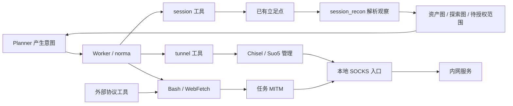
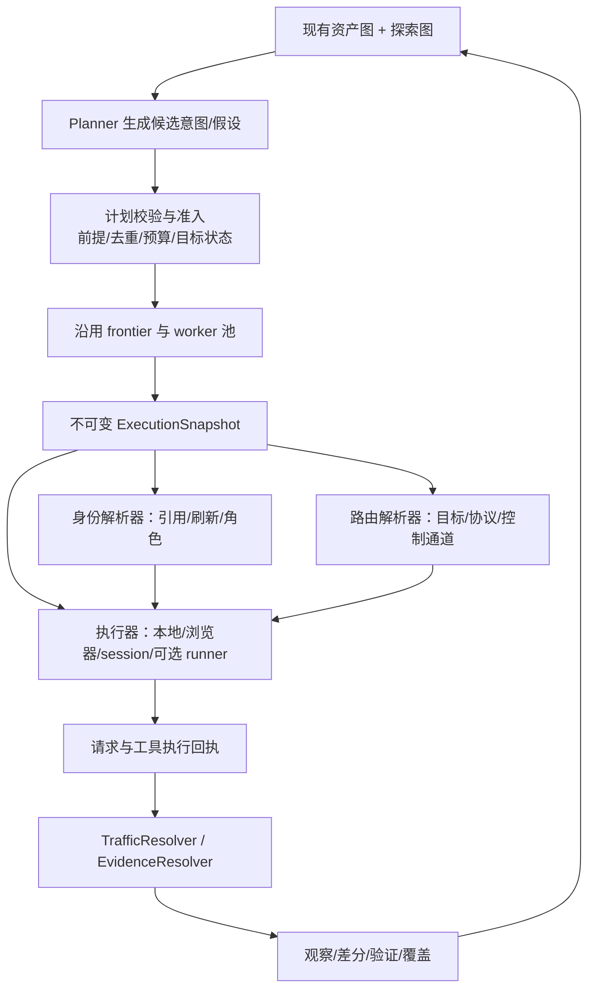

# YMH 能力评估与演进方案

评估日期：2026-10-21（Asia/Taipei）。对象：`E:/cyberagent/artex-ymh-main/artex-ymh-main` 当前源码，以及本地 CyberStrike 和下列官方开源资料。

这是初次架构评估和实施设计，不是完整的已实现功能清单。后续已按用户授权修改首批稳定性代码，具体实现、子代理复审和隔离测试见 [YMH-稳定性加固实施记录](YMH-稳定性加固实施记录.md)。本文件其余内容保留最初评估时的现状与演进建议；不能把全部方案视为已经落地。初次评估没有读取运行配置来推断功能开关，所以“存在这条代码路径”不代表当前实例已经开启该路径。

## 1. 结论与直接回答

**保留 Go + PostgreSQL + norma + 双图 + 事件驱动 planner/worker，增量扩展框架。优先投资执行一致性、可验证的状态和闭环编排。**

YMH 已经具备可用的基础：全局资产图、任务探索图、并发 worker、意图控制、冷压缩、延迟 MCP、流量证据、复测、受管会话、受管隧道和范围管理。主要短板是这些子系统尚未共用完整的执行上下文。模型还需要从散文、命令输出和多个台账中自行拼出身份、路由、前提及结论；这个负担直接影响 Web 深度和内网稳定性。

用户问题的回答：

1. **内网能力主要依赖什么？** 已有立足点上的 `session.Session` 执行能力，外部工具实际提供的协议能力，Chisel/Suo5 受管隧道，任务代理接线，以及 LLM 利用提示词/skills 对它们编排。平台自身负责会话、隧道、侦察、台账、范围、证据和调度；17 项工具清单不等于已安装、已注册、协议已接通或端到端支持。
2. **编排最该优化什么？** 把“前提是否满足、执行位置是否合适、路由是否可达、身份是否有效、证据是否足以支撑结论”放入可检查的数据与代码。保留 LLM 生成假设和选择下一步的弹性。
3. **Web 如何增强？** 先连接代理/浏览器/流量工具/证据存储，再增加请求模板、身份状态、多角色对照、差分判据和可解释覆盖。
4. **内网如何增强？** 从“任务默认 SOCKS”演进到按目标选择路由，补齐会话控制面的路由消费、平台能力匹配、拓扑证据和资源依赖管理。
5. **看完其他项目的想法？** 值得集合的是请求模型、能力契约、确定性计划校验和证据接口。大量 agents、skills、扫描器或额外数据库本身不能替代这些契约。

## 2. 已有能力：应保留并继续利用

| 能力维度 | YMH 当前实现 | 本轮建议定位 |
|---|---|---|
| 资产与推理状态 | 全局资产图 + 每任务探索图，资产锚点与来源关系 | 沿用，不另建互相矛盾的图 |
| 编排 | 图变化唤醒 planner，worker 领取 intent；暂停、续跑、steer/kill/cancel | 增加可检查前提、去重和收敛状态 |
| 调度约束 | planner frontier 上限、优先级、任务/意图预算、LLM 超时与失败转移 | 补跨调用资源预算和依赖感知 |
| 上下文 | overview 摘要、明细检索、cold compaction、工作过程检索 | 补结构化工作集与不可压缩字段 |
| 工具发现 | DB 工具目录、agent 绑定、MCP deferred/schema 延迟、skill 解锁 | 增加运行能力和健康状态；无需从零再做 lazy tools |
| Web 请求 | Bash/WebFetch、任务代理、流量搜索/读取、浏览器 MCP | 优先修复执行和证据的接线一致性 |
| Web 知识 | 九类 chains 骨架、refs、Web recon、类别判据 | 扩展确定性场景触发和覆盖记账 |
| 漏洞证据 | 不可变流量快照、baseline/proof/verification 引用、finding 验证与复测 | 复用，增加结构化重放与独立验证输入 |
| 会话 | HTTP 明文/加密会话、Penelope reverse 适配、探活和会话工具 | 补平台/执行/路由能力契约 |
| 内网侦察 | 经 session 运行命令包，解析 NIC/路由/连接并落资产 | 补 OS 选择、绑定地址、观察来源与有效期 |
| 隧道 | Chisel/Suo5 选型、部署/探活/列举/拆除、健康处理 | 补按目标选路、控制面与资源依赖 |
| 凭据 | 加密存储、来源、verified 字段、复用评分 | 补逐服务认证结果及可达性约束 |
| 范围与不可信输入 | scope/RoE、审批、目标内容隔离、出口与陷阱防线 | 接入新工具，不绕过已有控制路径 |
| 报告与运营 | finding 报告、人工复测、通知、活动流、LLM 用量记录 | 增加从决策到请求/结果的统一关联 |

重要依据：`agent/assembly.go:16`、`agent/deferred.go:10`、`agent/toolcatalog.go:11`、`agent/worker.go:461`、`agent/compaction.go:64`、`agent/tools_dispatch.go:14`、`agent/stuck.go:30`、`server/engine.go:88`。

## 3. 当前内网实际链路与能力边界



这条路径有四个必须分开的概念：

- **执行位置**：命令是在平台主机、某个受管 runner，还是经会话在立足点运行。
- **流量路由**：平台上的某个请求经哪个入口访问哪个目的地址。
- **会话控制通道**：平台如何继续访问那个会话自身。
- **协议能力**：工具是否真正支持该协议、代理方式、DNS 解析方式和平台。

仅设 HTTP_PROXY/ALL_PROXY 不能证明任意工具的 TCP、UDP、原始套接字或远端名称解析已按预期工作。需要能力矩阵和每条路径的验证结果。当前多种隧道原语已经存在，但实际默认选择仍是“该任务最新 alive SOCKS”；这不足以表达分支网段、多路径并存及控制面依赖。

已有红日复盘可以证明曾完成相当一部分链路，同时文档明确最后阶段包含人工提供凭据。不能把一次带人工输入的通关视为自主端到端能力或泛化成绩。复盘提出的问题也有一部分已在当前代码修复，例如 frontier 上限、kill/cancel、chains 自动骨架和同质响应检测；本方案没有把旧问题全当作当前缺失。

## 4. 优先核实和修复的源码问题

### F01：任务流量采集与读取不在同一个存储上下文（P0）

调用链证据：

- `agent/worker.go:475` 选择 task proxy；`server/taskproxy.go:141` 为任务创建独立 `traffic.Open`，独立目录和索引。
- `server/manager.go:918` 的 HostTools 返回 `m.traffic.Tools()`，即全局工具实例。
- `server/finding_traffic.go:23` 创建 evidence.Store 时传入全局 `m.traffic`；`evidence/store.go:168` 通过该实例读原始证据。
- `server/manager.go:729` 的 browser MCP 代理来自全局 `m.ProxyAddr()`。

静态审阅未发现将这些任务 traffic 实例聚合或按任务委派给工具/证据的接线。**当任务代理路径启用时，存在任务抓到的请求无法被默认流量工具找到、无法正确绑定证据，以及浏览器未消费任务内网路径的风险。** 未运行双任务集成测试，因此不宣称生产实例已复现数据混绑或丢失。

这是 S0 的第一验收项，不宜先增加更多 Web agents 来放大这个缺口。

### F02：内网路由消费与录制开关耦合（P0）

`server/manager.go:971` 在 `!TrafficEnabled()` 时直接不给任务代理。关闭抓包可能同时失去 worker 的任务隧道出口。需要把 egress route 和 capture policy 分开；不录制仍可消费指定路由。

### F03：任务单一最新路由与 HTTP 会话直连限制多路径（P1）

`server/taskproxy.go:61`、`:64` 按最新 alive SOCKS 选上游，未按目的网段和路径能力选路。`session/http_shell.go:99` 的 DirectHTTPClient 明确不使用代理。后者可避免环境代理污染，但目前也没有显式的会话 route resolver；处于更深路径的 HTTP 会话不能自然消费已有隧道。

应保留“直连是一种明确选择”的语义，同时增加显式、可审计、可探活的控制路由。不能把环境全局代理直接塞给所有会话。

### F04：OS 解析能力与端到端执行能力不同（P1）

`server/session_recon.go:31` 命令包偏 Linux；`tunnel/plan.go:123` 使用 `/tmp`；`tunnel/deploy.go:293`、`:334` 使用 Unix 命令。虽然 recon 有 Windows 输出解析器，当前托管路径仍不能据此宣称 Windows 全链路支持。

### F05：监听观察可能被提升为过强的服务可达结论（P1）

`recon/recon.go:56` 的 Listener 未保留绑定地址，`server/session_recon.go:155`、`:182` 把监听服务挂到首个非回环 NIC。仅回环监听与对外监听不能等同；多网卡也不能凭第一块网卡推断。需要保留观察地址和来源，另行记录“从某 route 已验证可达”。

### F06：凭据存在不等于认证已验证（P1）

已有 CredentialStore 和 verified，不应重做一套。需要修正 `server/credentials.go:45` 起工具描述/参数与 verified 接线不一致，并把认证结果按服务、主体、目标、路由和时间记录。`db/credential_score.go:80` 的“凭据有 domain 就给候选加分”不能证明目标属于同一域或可认证；分数只能作线索排序。

### F07：资源清理函数存在，但未接入完整生命周期（P1）

`tunnel/health.go:232` 已有 Cleanup；全仓非测试 Go 源码检索未找到调用点。`server/engine.go:301` 清理任务代理，`server/intranet.go:432` 的会话删除没有先处理依赖隧道。`tunnel/health.go:200` 起部分远端清理失败只写日志，最终仍可能记为 stopped。需要区分本地停止与远端清理确认，并尊重仍被移交任务引用的资源。

### F08：没有新前提时仍可能被提示词要求继续派单（P1）

`agent/planner.go:298`、`:463` 要求目标未达成且无 open/running 时必须产生意图。已有 blocked、exhausted 和人工控制，但缺少基于前提变化的确定性准入及全局重复抑制。没有新证据时，这条规则可能造成重述旧方向。`server/engine.go:1351` 的领取主要按 frontier 优先级与原子 ClaimIntent；应在此加入计划校验和依赖检查。

### F09：Session/Tunnel 操作需要明确任务归属或共享授权（P0）

`server/session.go:540` 的 lookupSession 只按注册表 ID 查找，`server/tunnel.go:458` 的 teardown 直接按 tunnel ID 执行。本轮未在这些路径发现每次操作的任务 owner/grant 检查。现有通用权限/拦截钩子仍存在，不能把它们说成完全没有权限控制；但仅凭工具名和全局资源 ID，难以可靠表达任务级资源使用边界。

应在 S0 加入结构化 OperationEnvelope 和 resource grant，分别验证“谁获准使用资源”和“资源被谁引用”。handoff 子任务仍使用来源 session，不能用 CreatedByTask 相等代替授权；移交要显式建立 grant/provenance，再持有资源引用。

## 5. 开源项目能力集合与取舍

这是按能力维度选取的代表性集合，未穷尽所有 GitHub 项目，也没有独立复现其 README 自报成绩。源码实现、官方文档、商业版描述分开对待。

| 项目 | 本轮核验到的机制 | YMH 可吸收 | 不应据此推断或照搬 |
|---|---|---|---|
| 本地 CyberStrike | 代理接入/队列、结构化 HTTP 对照、凭据选择、漏洞类分派、测试清单、延迟工具、外部 Bolt MCP | 请求→身份→对照→专题 worker→证据/覆盖闭环 | agents/skills 数量不是能力成绩；winhook/linuxhook 是内置脚本包装并依赖本机系统/工具，Bolt 才是远端通道；队列、预算与缓存的生命周期要另审 |
| [Strix](https://github.com/usestrix/strix) | 浏览器/代理/终端/Python 工具面、agents 协作、验证与报告机制；本轮 Web 子报告含源码引用 | 统一工具体验、按发现按需分派、验证交付 | 不把 Cloud/Enterprise 文案全部当作开源实现，也不比较未经复现的命中率 |
| [Shannon](https://github.com/KeygraphHQ/shannon) | 认证预检、侦察、按类分析/验证、报告阶段；Temporal 管线和 workspace/checkpoint；源码上下文参与分析 | 身份预检、阶段产物契约、阶段恢复、可选白盒上下文 | 其开源定位偏白盒；不把商业黑盒能力当开源能力，也不把固定阶段直接替换 YMH 事件探索 |
| [PentestGPT](https://github.com/GreyDGL/PentestGPT/blob/e8b1bb77d1ac00329675cec3b060aba971ec1ac8/docs/architecture.md) | 当前维护框架为 Supervisor→compile_plan→TaskLease→Executor→compile_execution→MemoryKernel；明确持久真值与诊断 trace 的区别 | 在 LLM 意图和真实执行之间放确定性编译/准入，租约与结果回执 | 不沿用过时的“只有三会话 PTT”介绍；其单任务串行调度不直接适用于 YMH 并发 |
| [PentAGI](https://github.com/vxcontrol/pentagi) | 沙箱、专职 agent、持久记忆、执行监视/任务规划模板、可选观测栈 | 任务进展审视、执行隔离、用量/效果关联、受控经验复用 | 不为功能对齐一次引入 Neo4j/Redis/ClickHouse 等整套可选依赖；已有 PG 双图先够用 |
| [CALDERA 官方文档](https://caldera.readthedocs.io/en/latest/Learning-the-terminology.html) | ability 的平台/executor/requirements/parsers/cleanup，满足 facts/执行器/重复规则才产生执行 link | 把能力做成声明式合同，前提和结果由代码验证 | ATT&CK 标签不自动产生协议实现；不把战术状态机硬套成唯一探索顺序 |
| [AutoPenBench](https://github.com/lucagioacchini/auto-pen-bench) | 可重置实验任务、工具 schema、agent 评估接口 | 固定环境、任务真值、重复运行与阶段指标 | 不将外部基准分数直接当作本项目成绩 |

**集合后的目标能力**：资产发现、请求与浏览器状态、身份、协议/执行器能力、路由、依赖编排、观察与假设、证据、复测、持久恢复、用量观测、实验评价。YMH 不缺其中大部分原语，主要缺把它们连成同一契约的层。

本地 CyberStrike 需要注意的反例：lazy registry 的预算超限部分路径只告警；普通请求路径中的 GlobalBudget/CircuitBreaker 实例化位置不能提供预期的跨调用共享效果。借鉴接口时必须一并设计实例生命周期和并发原子性，详见子报告。

## 6. 目标架构：在现有双图之间加入可检查的执行层



新增层应是 Go 包和清晰接口，首先运行在现有单体内。先让状态、上下文和恢复语义正确，再决定是否拆出远程工具执行节点。

建议的最小执行快照：

```text
ExecutionSnapshot {
  execution_id, attempt_id, task_id, exploration_id, intent_id,
  plan_revision, executor_id, capability_version,
  route_id, route_version, dns_policy,
  identity_ref, auth_state_version,
  traffic_store_id, capture_policy, scope_revision,
  budget_reservation_id, tool_version, request_template_version
}
```

快照只含引用及版本，不把密码、Cookie 或 token 原文塞进 planner。每次执行固定快照；路由中途变化不能悄悄改变同一个实验的出口。依赖失效先结算该 attempt，重试时重新解析并产生新版本。

快照固定的是实验环境版本，不能使过期授权继续有效：每次出站、HTTP 重定向、浏览器导航/子资源都按当前授权撤销状态重新校验。不同目的地址可在固定 route policy 版本内解析到不同 route，实际每跳 route/DNS 结果写入回执。能力不能支持逐跳约束时显式返回 unsupported。

OperationEnvelope 由工具适配层从可信运行上下文构造，包含 task/intent、resource/executor 引用、target、protocol、effect、identity、scope_revision；先验证任务资源 grant、范围和能力，再预约执行资源。API、agent 工具与异步恢复使用同一个检查入口。

ExecutionReceipt 记录 execution/attempt ID、调度租约及 fencing token、计划/授权版本、实际 tool/executor/route/auth 引用、起止时间、原始 artifact hashes、观察、采集状态和终止原因。迟到的旧 attempt 不可覆盖新状态。调度租约、路径版本和资源生命周期分开管理；租约过期不自动重做有副作用的动作，先核对回执与实际作业状态。回执证明发生了什么，finding 仍由验证层判定。

不是所有工具都需要全部字段。请求工具、文件工具和会话工具应有各自能力声明，不能为统一而强迫所有工具依赖浏览器或 HTTP。

## 7. 实施工作包

以下每个工作包由对应子代理提出或复核；三方已完整交叉审阅并确认修订落实。编号可直接用作后续实现任务。

### 7.0 当前进度（截至 2026-10-24）

本节由后续实施回写，用于回答「12 个包到底做到哪了」。**只有明确写出的子集算完成**，其余一律按未做计。

> **本表只到「包」这一级。** 事项级的待办、优先级、以及每一项的 `file:line` 现状证据，统一见 [`2026-10-23/YMH-待办总表.md`](../2026-10-23/YMH-待办总表.md)——那是仓库内唯一待办源，与本节冲突时以待办总表为准。
>
> **2026-10-24 全量收尾**（实施记录 [`2026-10-24/YMH-全量收尾实施记录.md`](../2026-10-24/YMH-全量收尾实施记录.md)）交付 15 项，10 个包从「未开始 / 部分」推进到「完成」或「仅剩一项刻意延后」。P0 已清空。
>
> 历史提醒（仍有效）：**「未做」这个结论必须回源码核实，不能沿用上一版表格。** 10-23 的审核发现 I3 曾被写成「未开始」，实际 `server/lateral_exec.go` 早已落地——真实缺口是 Linux/SSH 与认证账本，不是横向原语本身。

| 包 | 状态 | 已落地 | 仍未做 | 记录 |
| --- | --- | --- | --- | --- |
| S0 | **完成** | 资源授权、会话移交、流量/证据任务归属、补全走任务出口 | 统一 `execution/` 包与 ExecutionSnapshot 仍按需演进（不影响验收项） | `2026-10-23/YMH-补全出口与抓取预算修复实施记录.md` |
| W1 | **完成** | `authstate/`：身份真值 + 版本递增 + `Stale` 判定 + Cookie 名排序；8 例测试 | 尚未接入 worker（原语就绪，缺「差分实验」意图类型） | `2026-10-24/…` §4.1 |
| W2 | **完成** | `webtest.Replay` 单点变异 + `CompareWithNoise` 噪声标定 + `byteDiffRatio`；判定映射到既有 finding 三态 | 同上（未接 worker） | `2026-10-24/…` §4.2 |
| W3 | **完成** | `webtest.Frontier` 五轴覆盖 + `Source` 强制 + found 只升不降 + `FamilyStats` | 动态交互面（W12）仍需真实浏览器，见 T-20 | `2026-10-24/…` §4.2 |
| W4 | 部分 | `agent/verifier.go`、`agent/retester.go` | ExecutionRecipe 实体（T-19）；验证仍走进程内回调 | T-19 |
| I1 | **完成** | 按目标 host 选路；平台化探针；录制与路由解耦；HTTP 会话控制通道路由（含防环）；`reachable_ranges`/`dns_policy` 声明；**可达性自动探测（确定性采样 + refused 也算路通）** | 网段级路由（需要多网段真实环境） | `2026-10-24/…` §1.1 |
| I2 | **完成（执行通道）** | 平台抽象；`capability/` 合同 + 5 处前置检查 + 方言预检；**协议矩阵五协议全登记**；**SSH 真实接入（`x/crypto/ssh`）**；退出码三档 `real/inferred/none` | winrm / ldap / rdp（刻意延后：同模式重复劳动，无真实目标可验） | `2026-10-24/…` §2 |
| I3 | **完成** | 横向受管原语；认证账本 + 尝试预算；**`HasSuccess` 接入复用打分（50 分最强信号）**；**SSH 横向**；**Observation `artifact_ref` + sha256 + 拓扑边时效** | — | `2026-10-24/…` §1.2 / §2.1 / §5.2 |
| I4 | **完成** | 依赖逆序收尾；`CleanupPending`；孤儿标 error；会话租约；终态释放**端到端验证** | `desired_state`/`generation`（**刻意不加**，见总表 §5 N-01） | `2026-10-24/…` §1.5 |
| O1 | **完成** | 意图 inflight 唯一键；**`prerequisites`/`done_when` 判据 + `planning/` 六种判据语法 + 只报告不阻断** | `intent_done` 只看终态（保守选择） | `2026-10-24/…` §1.3 |
| O2 | **完成** | 部分诚实语义；**三段式工具合同**（`execution_status` × `failure_reason` × `assessment`）；**`BudgetService.Admit`**；**提示词拆五块** | — | `2026-10-24/…` §1.4 / §3 |
| E1 | **完成（26 项）** | `evals/scenarios.json` v3：**23 自动 + 3 人工**；`evals/run.ps1` 统计口径修正 | W12 / F06 仍是人工（需要真实浏览器 / 真实重启） | `2026-10-24/…` §6.1 |

读这张表时的三条提醒：

1. **「完成」指验收项有代码 + 测试支撑，不等于「在所有环境都能用」**。例如 I2 的 winrm/ldap/rdp 明确未实现，`capability/matrix.go` 里写清了 `Missing`，agent 不会反复试错。
2. **原语就绪 ≠ 已接入工作流**。`webtest` / `authstate` 是原语，worker 还没有「差分实验」这个意图类型。这是刻意的顺序：先有可靠原语，再有用例，比反过来省事。
3. **下一件优先级**见 `2026-10-23/YMH-待办总表.md` §2.2：T-19（ExecutionRecipe，需先做 T-23 持久化事件）> T-20（动态交互面，需真实浏览器）> T-24（前端验收）。

### S0 — 执行、路由和证据上下文一致性（P0）

**模块**：新增 `execution/`；修改 `agent/runinfo.go`、`agent/assembly.go`、`server/assembly.go`、`server/manager.go`、`server/taskproxy.go`、`server/finding_traffic.go`、`evidence/`、`traffic/` 以及 browser MCP 装配。

**交付**：

1. 沿用现有 WithRunInfo，新增 ExecutionSnapshot 和上下文 resolver。
2. 流量工具按任务和存储命名空间查询；历史记录按 `traffic_store_id + record_id` 定位。既支持已有全局记录，也支持任务记录，不能用“当前最新实例”替代历史寻址。
3. Browser 按任务/身份创建隔离 context 或实例，消费同一快照；记录 task、intent、identity 和 route 归属。
4. capture on/off 与 route selection 分离。指定内网路由不可用时返回显式依赖错误，禁止静默改用另一出口并把结果当作同一实验。
5. 流量检索、finding 绑定、报告、复测、归档/恢复及删除语义一并覆盖；实例关闭后仍能读历史证据。
6. Session/Tunnel 的 use/read/write/stop 在解析 ID 后统一检查任务 owner 或显式 grant；handoff 事务内建立新授权与 provenance，资源引用租约另记。流量/证据的跨任务读取默认拒绝，显式授权的来源继承可复制不可变快照并保留来源。
7. 采集状态区分 recorded、metadata_only、passthrough、error、unsupported，失败尝试也有最小诊断回执。空检索不能被解释为没执行；证据固化成功需取得持久化确认。

**验收**：两个隔离测试任务使用相同 hostname/URL、不同模拟上游。分别通过 Bash/WebFetch/Browser/verifier 产生记录，任务工具只能读到归属正确的记录；证据绑定、归档恢复后正文 hash 一致；未授权跨任务引用和 Session/Tunnel 操作被拒绝，显式 handoff 后仍可用；关闭抓包仍能走指定测试路由；强制 task proxy 创建失败时不会把另一路径结果误认为原路径结果；录制退化可以诊断，历史快照仍可验证。

### W1 — 请求模板与身份状态（P1）

**模块**：新增 `webtest/`、`authstate/`，扩展 DB 模型；工具层接入 S0。

**交付**：RequestTemplate 保留 method、URL、路径模板、参数位置/类型、重复参数、原始请求引用、正文类型、身份和状态前提。复用现有加密凭据仓，通过引用供执行器取用。AuthContext 明确 principal、role、tenant、origin、storage_state_ref 和版本；重放时取得 Cookie/header/CSRF 等，不复制过期秘密到提示词。匿名和多个授权身份的 context 隔离，保存登录验证、过期、刷新和业务状态前提。刷新有租约及并发控制，不能互相撤销 token。原有无凭据 API Recon 保持其阶段合同，真实认证探索由独立阶段消费 AuthContext。优先支持已有 HTTP/浏览器路径，不一开始覆盖所有协议。

**验收**：在本地 fixture 上支持 Cookie 过期、CSRF 轮换、302 登录、同站多角色和并行任务；身份过期输出 auth_expired/inconclusive，不能记作无漏洞；两个身份的 cookie jar 不相互污染；请求与实际字节/差分的对应关系可追溯。

### W2 — 差分实验与可验证判据（P1）

**模块**：`webtest/replay`、`webtest/compare`、现有 verifier/finding 工作流。

**交付**：把一次实验建模为 baseline、单变量变更、对照、重复确认和业务状态断言。有状态请求默认顺序执行；先确认或重置等价业务状态，CSRF/token 轮换时重新取状态和基线。只有声明可并行且无状态的实验才并行比较。先做身份/权限差异与 API 状态一致性，再扩展其他类别。实验输出 confirmed/refuted/inconclusive 和原因，并明确映射到现有 finding 的 verified/false_positive/inconclusive 流程，避免创建第二套 finding 状态。比较结构化字段、可见对象归属及副作用；状态码、页面长度和模型猜测仅是辅助信号。

**验收**：同样返回 200 的成功/失败页面、随机字段/时间戳、延迟抖动、权限差异和登录失效 fixture 中不误判；响应证据与业务断言都留存；实验总请求预算在共享 BudgetService 中原子扣减，跨 worker 并发不绕过。

### W3 — 带来源的 Web 覆盖与按需专业 worker（P1）

**模块**：扩展资产 endpoint、`enrich/`、`agent/tools.go` coverage、planner/worker，增加 discovery frontier。

**交付**：融合已抓流量、浏览器导航、JS 静态提取及用户提供的 API 描述。每个端点记录来源、实际观察、参数和身份；保留 static candidate、mock emitted、real backend observed 的区别，记录 sent_to_backend、original_status、原文引用及 UI_trigger。现有 preload 已有 source=mock 标记，应贯通后续脚本产物与资产入库，不能重复发明来源。未知 method 保持 unknown，不自动补 GET，mock 改写的 200 不可当正常后端基线。

覆盖单元建议为 `method × route template × parameter schema × identity/role × test family`，分轴记录发现来源、可达性、认证前提、执行状态和 verdict，不能把这些概念塞进单一互斥状态。保留现有粗资产 coverage，同时增加测试账本；现有 `db/task_scope.go:278` 起以任意 fact 锚定计 tested，只能说明粗粒度触达。端点数量本身不代表测试充分。

按目标和观察启用 API/授权/客户端等专题 worker；不让每个站点默认启动全部漏洞类。白盒源码、OpenAPI/GraphQL 等作为可选输入，只有实际运行的请求/行为能支持动态结论。

**验收**：本地 SPA、REST、多角色和文件流程的固定样本中可定位未测格子及原因；重复 URL 不膨胀覆盖，路径相同而 method/角色不同的测试不合并；报告给出分母与未知范围，不把“发现端点已访问”标成全面覆盖。

### W4 — 验证、复测与可选白盒协作（P2）

**模块**：沿用 `agent/verifier.go`、`agent/retester.go`、`evidence/`、`report/`，补 ExecutionRecipe。

**交付**：候选发现携带最小复现描述、前提、身份引用、baseline/proof/verification refs、断言和清理状态。验证者从原始不可变证据与独立复测取得结论，不把发现者的总结当证据。业务逻辑类允许业务状态证据，不机械要求每项都具有同一种 PoC。可选源码分析只提交带位置与数据流依据的假设，仍走同一验证门。

**验收**：发现者结论被故意写错、原始流量被清理、快照损坏、身份过期和服务已修复等场景中，分别得到证伪、仍可读快照、证据不足、前提失效及满足条件的已修复。只有身份/路由有效、正常对照通过且原行为消失时才支持已修复，不能合并成“无法复现所以安全”。既有人工复测链路继续可用。

### I1 — 按目标选择路由，补会话控制路由（P0 合同，P1 完整能力）

**模块**：新增 `routing/`；扩展 `session/`、`tunnel/`、`server/taskproxy.go` 和 session 登记/探活。

**交付**：路由实体记录 reachable ranges、入口、父路径、DNS 策略、协议能力、健康度、验证时间、依赖资源和版本。reachable ranges 是候选路由声明，实际可达性须有 source/destination/protocol/DNS/tested_at/TTL 的观察支撑。目标解析采用确定性优先规则（任务绑定、目的范围、能力、健康/代价），现有默认路由仅用于明确允许默认出口的兼容操作；指定路径失败不消费 legacy 回落。HTTP 会话支持显式 control_route_id，控制连接使用 route-aware client；防止会话经由依赖自身的隧道造成循环。

路由健康必须验证目的方向，不能把本地 SOCKS 端口打开视为所有网段可达。多层是有依赖的连接组合，分支网段则可同时使用不同路径。

**验收**：隔离网络中两个分支网段同时可访问，单路径切换不破坏另一路径；第二层 HTTP 会话可经已登记路径探活；路径失效只阻塞依赖它的 intent；控制路径无环；记录固定路由版本，重试有新的 attempt。

### I2 — 能力感知执行、协议与平台契约（P1）

**模块**：扩展 `session.Session` 元数据和外部工具描述；新增 `capability/`；修改 recon 和 tunnel plan/deploy；未来接入 thin runner。

**交付**：执行器明确本地/会话/runner、OS/架构、shell、文件读写、交互、协议/代理/DNS 支持、工具版本和健康状态。选择只读侦察命令包与文件路径前检查能力。工具 manifest 的“文件存在”和“能提供目标能力”分开检查；不适配的平台返回 unsupported，不能反复试错后记成目标失败。

能力还应声明 supports_exit_status、job_tracking、streaming、cancellation_semantics。可观测执行状态区分 started/running/completed/unknown、cancel_requested/cancel_confirmed；平台结束等待只能报告 timeout，不能擅自写成目标作业已结束。不支持取消的驱动返回 cancel_unsupported，迟到输出按 job/call 归属隔离。

**验收**：Windows、Linux、受限会话与缺依赖 fixture 中不派不支持的命令；Unix 模板不会发给 Windows；工具不可用时得到 capability_missing；协议超时、路由失败与认证失败可区分。先完成本地能力合同，远程节点后续只实现相同合同。

### I3 — 拓扑观察和认证结果成为可核验实体（P1）

**模块**：扩展 `recon/`、`server/session_recon.go`、`db/credentials.go`、`db/credential_score.go`、内网 UI。

**交付**：Observation 保存 observer_session、route、采集命令、原始 artifact_ref + hash、时间、绑定地址和 confidence；hash 不能替代可读取原文。拓扑边有 observed/inferred/verified 及有效期；NIC、邻居、路由、监听、远端服务可达性分别建模。首 NIC 上的服务推断不自动提升成远程可达事实。

认证结果按 `principal + credential_ref + service + target + route + auth_method + time` 记录。复用评分先筛选范围、可达、协议与已知身份域，再排序；失败缓存和账户锁定/尝试预算进入准入。修正 add_credential 参数说明与字段接线，verified 只能由明确验证记录支撑。

W1 和 I3 共用同一个 identity_ref/principal/auth version 模型，避免 Web/内网各建身份真值。传输可达性变化与账号认证结论的适用性分别判断，不因每次代理实例重建就无条件使账号失效。

**验收**：loopback-only 服务不会变成远程可达；多网卡服务归属不乱；路线变更后旧超时不能永久否定目标；一个服务的认证成功不能自动证明其他服务/身份成功；证据来源可展开查看。

### I4 — 会话/隧道资源依赖与生命周期（P1）

**模块**：`tunnel/health.go`、`session/manager`、`server/engine.go`、handoff、删除/归档与启动恢复。

**交付**：资源依赖图、独立的 grant/引用/租约、心跳、幂等 stop 和 restart reconciliation。任务终态先停止调度并 drain，按依赖逆序释放；仍被移交任务使用的资源保留引用。stop 先持久化 desired_state=stopped 及 generation，再清理，健康循环和重拉需比较版本，避免用户停止后自动再部署。状态至少区分运行、停止请求、局部停止、cleanup_pending、清理已确认。远端不可达时诚实保留待清理记录，后续重试，不承诺无法观测的远端已消失；调用 timeout/cancel 也不等于远端进程已停止。

**验收**：会话删除、任务停止/归档、服务重启、隧道进程退出和远端不可达 fixture 中无悬空引用；共享会话不会被一个任务终止误删；失败不虚记 clean；重复 stop 不产生额外副作用。

### O1 — 意图准入、假设/实验账本与收敛（P1）

**模块**：新增 `planning/`，扩展现有 intent payload/DB、`agent/tools.go`、`agent/planner.go`、`server/engine.go`。

**交付**：

1. 候选意图包含 objective、done_when、basis/evidence IDs、typed prerequisites、expected observations、预算和 capability requirements。
2. 计划先编译/校验，再入 frontier。领取时原子检查版本、依赖和资源预留；执行前复查可能变化的 scope/身份/路由。
3. 沿用 blocked 状态，区分 transport_error、unmet_prerequisite、awaiting_input 等原因；依赖变化定向唤醒，替换“没 active 就必须再派”的规则。
4. Hypothesis 保存待判定命题、支持/反驳引用、下一项能区分结果的实验和环境版本。先用现有 fact/hint 的结构化扩展加必要索引；确有查询/更新需求才拆单独表，不另起一套事实真值。
5. 跨 worker inflight 唯一键抑制重复：目标模板、参数形状、具体身份/主体及 context、test family、执行/路径语义指纹、方法版本。同角色的不同用户不能无条件共享授权实验结果。同一实验的阴性结论只在有效前提版本内复用；区分语义环境变化与代理端口/进程重建等技术版本变化，避免每次重建触发无限重测。
6. 无新前提、无可执行实验时输出等待原因或“当前预算/覆盖下未达成”；这与成功是不同结论。

并发去重必须有 task namespace；依赖/版本检查、预算预留、inflight 唯一键与状态领取置于同一个事务。外部操作仍可能在事务后环境失效，因此执行前检查和回执结算必不可少。若复用 blocked 表达等待，必须同步修改 coldgraph settled 判定、HasActiveIntent、完成判定、重开和压缩规则；保留 transport_error 原恢复策略。planner todo 当前为内存结构，恢复所需的下一前提/步骤应持久化在 canonical 状态，不能只依赖 todo。

Hypothesis 即使复用 fact/hint 载体，也必须有独立 subtype/status 和可区分的读取接口；不得自动作为 confirmed fact、verified coverage 或 prove_goal 的依据。只有验证层生成/关联的证据支持结论后才可进入既有证明流程。

**验收**：依赖未就绪不启动下游；三个 worker 并发提交同一实验只准入一次；身份/路由更新后合理复测可重新准入；已证伪方向不会仅换措辞重新排队；必要人工输入缺失时能解释等待，而不是持续烧 token。

### O2 — 工具合同、预算、上下文与提示词（P1，与 O1 同步）

**模块**：`agent/assembly.go`、`agent/toolcatalog.go`、`agent/deferred.go`、`agent/promptcatalog.go`、chainskel、工具运行层。

**交付**：

- ToolCapability 声明前提、输入/输出 schema、执行位置、可重试性、幂等性、结果解析器和资源影响。结果分 execution_status（succeeded/failed/timeout/cancelled/unsupported）、failure_reason（如 auth_expired/transport_error）和 assessment/verdict；工具退出成功不代表目标阴性或漏洞阳性，原始输出仍可引用。
- BudgetService 是任务/资源级共享服务，覆盖请求数、并发、时间与用量；不能在每次请求里新建预算器。先透明排序：目标推进/新信息/解锁依赖的价值，相对于预期成本与工具健康；权重经过 E1 评价再调。
- 保留现有 LLM profiles、限流、健康与失败转移，按规划/执行/验证角色做基准选择；不按模型名字盲目分级。
- 上下文只取当前意图、直接依赖、目标服务、身份/路由摘要及证据引用。冷压缩必须保留 ID、版本、否定条件和待满足前提；摘要不能成为原始证据。
- 保留 deferred MCP/skills，按能力查询再暴露 schema。全局函数接线逐步收敛为显式 runtime resolver，便于多任务与集成测试。

优先修订已存在的强断言：`agent/chainskel/web.md:9` 的单一固定回显判据、`:13` 的固定步骤，以及 `agent/chainskel/meta_rules.go:24`、`:31` 的“工具阳性可信”等表述。替换成带正常对照、替代解释和证据门槛的判据，不能只继续加长提示词。

**提示词拆为五块**：稳定职责；当前 goal/intent；结构化状态；本次场景判据；输出/停止合同。按 endpoint/认证状态、协议、可用 session、失败类型及观察触发场景；保留 chain_tags/关键词作为兜底。

worker 输出合同示意：

```text
本次需判定的命题；执行前提及版本；使用的执行器/身份/路由引用；
预期可观察差异；实际观察与证据引用；结论及不能排除的解释；
覆盖变化；下一前提或停止原因。
```

这个输出是结果报告结构，不要求保存模型私有推理。重复控制、前提校验和证据归属由代码执行，提示词负责解释和引导。

**验收**：同一任务跨 turn/并发共享预算；MCP 中断后的恢复仍能解锁已授权工具；压缩后可以重建未完成前提；工具失败不被误记为目标阴性结论；改 prompt 的收益能被 E1 单独测量。

### E1 — 固定基线、消融与观测（P0 起建，持续执行）

**模块**：新增 `evals/`、fixture/回放清单、只读运行对比报告；沿用已有 activity、llmrec、evidence、tests。

**第一套建议样本**：Web 12 个、内网/路由 8 个、故障恢复 6 个，共 26 个可重置场景。包括多角色、过期身份、动态前端、随机响应、单路径/分支/两层控制通道、回环监听、Windows 不支持能力、代理中断、进程退出及重启。场景数量是首轮工作量建议，不是已有测试或已证明的覆盖规模。

资源归属/恢复样本至少包含：未授权的 Session/Tunnel ID 操作、合法 handoff 后使用及 grant 撤销、stop 与健康重拉竞态、远端命令 timeout 后的状态核对。这四类纳入上述首套场景，不用单纯增加样本计数代替覆盖关键失败模式。

**评价方法**：固定应用版本、环境拓扑、模型配置、工具版本、token/请求/时间预算和人工输入。每配置至少重复 3 次做初筛；置信区间跨过零或方差较大时增加重复，3 次不能证明泛化提升。按场景成对比较当前基线与改进版，再分别消融“只改 prompt / 加结构化工具 / 加依赖路由 / 完整方案”，避免把换模型或人工提示的收益误算成框架收益。

**记录指标**：任务与阶段成功率、可复现 finding 精度/召回、inconclusive 比例、已声明覆盖的真实性、有效新观察/请求、重复实验率、前提失败率、路由诊断准确性、证据可重放率、恢复成功率、时间/请求/token 成本、人工干预次数。精度/召回仅在已知真值的 fixture 中计算；未知实际环境不声称可知完整召回率。

**硬性验收**：同任务身份/路由/证据归属一致，跨任务隔离 fixture 全过；状态转换与原始证据可审计；故障不会假记目标无漏洞或清理完成。效果提升作为待证假设，初始目标可设为重复实验率下降 30%、同预算覆盖提高 15%，未达标必须报告结果，不把目标写成成绩。

**受控经验复用**：将通过独立验证的请求模板、环境条件和失败模式存为带版本、来源、有效期的经验；跨任务只取匹配场景的模板。先用 PG/全文检索；语义召回必须保留原始 ID 和来源，不能把旧凭据、旧会话或过期结论自动当作新任务事实。

## 8. 数据模型与接口实施边界

建议逻辑实体：ExecutionSnapshot/Receipt、ToolCapability、Route/RouteObservation、RequestTemplate、AuthContext、TestCase/TestRun、AuthResult、Observation、ResourceDependency/Grant/Reference/Lease。不是要求第一期同时为这些概念分别新增表。

- 原始资产与真实发现继续放现有系统；执行元数据通过 task/intent/asset/evidence 外键关联。
- 能用现有 payload 加 schema/version 和索引解决的先增量扩展；高频可变状态、并发预算和引用完整性单独建表。
- 流量命名空间必须贯通 capture、lookup、snapshot、archive/restore。历史全局证据支持带明确 legacy store 标记的读取，禁止跨存储猜测同名 ID。
- 采用 PostgreSQL 事务 + 原子状态比较 + 必要的 outbox/reconciliation，先覆盖单体崩溃恢复。外部工具的副作用不能宣称 exactly-once；读操作可重试，有副作用操作先检查回执/前后状态再决定是否重做。
- 预算保留 reserved/consumed/released 账目；只有未发出的预留可释放。请求已经发送、尤其有副作用后超时，不能因没有完整响应退还消费并自动重放。
- 后续远程 runner 可复用工具合同；节点身份、租约/fencing、心跳、取消、结果/产物传输、升级兼容和重启对账仍需独立工程化，不能视为只加 RPC。仓库 `DISTRIBUTED-DESIGN.md` 标记为待评审设计；本次未找到对应完整 node runtime，不能当作已交付能力。

## 9. 实施顺序与投入估计

以下为熟悉当前代码的一名后端开发者、配合实验环境支持的粗估人日；不是排期承诺。接口设计、测试失败和平台适配会改变估计，先做 S0/E1 再校准。

| 阶段 | 工作包 | 依赖 | 交付门槛 | 粗估 |
|---|---|---|---|---|
| A：正确性基线 | S0 + E1 最小集，确定 I1 路由合同及 I4 终止/共享引用语义 | 无 | 两任务流量/身份/证据一致，资源授权/移交可检查，抓包开关不改路由语义 | 6–10 人日 |
| B1：Web 深度 | W1→W2→W3，O2 共享预算 | S0 | 多身份请求对照、可解释覆盖，避免前提失效误报 | 8–14 人日 |
| B2：内网链路 | I1→I2/I3，I4 生命周期 | S0 | 分支/两层控制通道、能力匹配和清理对账 | 10–16 人日 |
| C：编排收敛 | O1 + O2 完整版、W4、E1 消融 | S0；逐步使用 B 的模型 | 依赖准入、重复抑制、恢复、独立验证 | 8–14 人日 |

合计粗估 32–54 人日，包含场景化集成验证。远程节点全面产品化、大规模分布式、全协议支持与 UI 大改不在此估计内。若资源有限，先完成 A，再在 B1/B2 选一条完成闭环；O1 的前提合同设计应从 A 同步确定，避免返工。

MVP 边界：A 只覆盖本地执行器的完整垂直路径；B1 限现有 HTTP/Browser、常见请求格式和已有授权身份，不含通用 SSO/MFA 自动化适配；B2 不含新增 SSH 会话驱动、完整 Windows 原生隧道驱动或全协议统一代理。Windows fixture 首先验证能力选择正确与 unsupported 语义。若要这些扩展，需要另估投入。

A 的 6–10 人日仅按少数核心工具、新运行、legacy 只读兼容和最小隔离场景估计，不承诺完成全部历史迁移、全部工具适配或 26 场景。完整 26 场景随 B/C 逐步交付。O1 最小准入/receipt 合同与现有独立 verifier 的上下文修复从 A 开始；W4 的 P2 只指新增 recipe/白盒扩展。

每个包以功能开关/兼容适配接入。先用只读影子模式记录新 resolver/准入器的选择差异，不额外发送目标请求；再在隔离 fixture 切换，最后逐个迁移工具。迁移含既有资源 grant/ref 及 provenance 的显式回填，回滚不能删除已产生的 receipts、原文产物或证据。不能长期保留两套可写事实、身份和证据真值。

legacy 资源授权只能依据可证明的任务/移交关系回填，有歧义记录只读并要求显式授权，不能把现有全局 ID 自动转成所有任务可用。schema/version、幂等 backfill、校验统计和可恢复 checkpoint 应进入迁移交付物；store_id 稳定且不可回收复用。

## 10. 本轮建议暂缓的扩展

1. 全面换成 LangGraph/CrewAI 或把 Go 核心推倒重写：当前限制主要在执行合同与状态，不是缺少某个编排库。
2. 默认启动所有专题 agent、把数千 skills 注入上下文：增加成本和分歧，不能解决前提和证据错误。
3. 立即上完整微服务/Temporal/Neo4j/向量栈：可学习其恢复/检索机制，先以现有 PG 和单体接口验证需求。
4. 以隐蔽、持久化或更大工具库作为主线：本轮目标最直接的收益来自 Web 请求深度、链路可达性、事实准确性及可重复实验。
5. 把人工干预、扫描器命中或工具输出 SUCCESS 当作自主完成证明：完成状态应有独立证据和明确前提。

## 11. 多代理讨论与复核记录

研究分工：Web 代理深入 Web/HTTP/Browser/证据；内网代理深入 Session/Tunnel/Recon/拓扑/凭据；对照代理深入 CyberStrike 与 YMH 编排/工具/上下文；主代理核对调用链、研究其余开源项目并整合方案。

已发生的交叉讨论：Web 首先发现 task traffic 与全局读取接线差异；内网代理独立追踪并确认没有聚合兜底，补充 capture/egress 耦合；对照代理提出不可变快照和共享预算实例生命周期。三方同意保留双图/现有 worker 池，借鉴外部能力合同与验证闭环。

| 工作包 | 主审视角 | 交叉复核视角 |
|---|---|---|
| S0 | Web + 内网 | 对照/编排 |
| W1–W4 | Web | 对照/编排 + 内网身份/路由 |
| I1–I4 | 内网 | Web 控制/证据 + 对照/编排 |
| O1–O2 | 对照/编排 | Web + 内网前提模型 |
| E1、数据模型、迁移/排期 | 主代理整合 | 三个子代理全部复核 |

统一方案复核状态：**三个子代理均已完整审阅全部 12 个工作包、数据模型、迁移与投入估计；修订后全部接受为实施设计基线，无剩余阻塞意见。** 这表示设计讨论完成，不表示实现或效果已通过动态验收。

复审落实的关键修改：资源 grant 与引用分离；有状态差分顺序与业务状态隔离；覆盖分轴及 mock/原始状态来源；执行状态与漏洞 verdict 分层；不可变回执/fencing 和副作用对账；等待状态与终态/压缩联动；身份语义去重及原子预算；历史证据/合法移交/回滚合同；受限 MVP 投入边界。

原始研究：[Web](web-review.md)、[内网](intranet-review.md)、[CyberStrike/编排](cyberstrike-review.md)。逐包复审与修订确认：[Web 复审](web-final-review.md)、[内网复审](intranet-final-review.md)、[编排复审](orchestration-final-review.md)。

## 12. 来源、版本与核验范围

### 本地源码

YMH 当前目录没有可用 `.git` 元数据，不能声称已对应某个提交；以本轮读取的文件/行号为准。CyberStrike 本地 HEAD 为 `ec4fe5c4252668f2acea7665e7c7c1edcd892c65`，读取时工作区无改动。代码引用为本地文件，一旦后续修改行号可能变化。

- [YMH worker](../../../agent/worker.go)、[工具装配](../../../agent/assembly.go)、[延迟工具](../../../agent/deferred.go)、[工具目录](../../../agent/toolcatalog.go)、[planner](../../../agent/planner.go)、[engine](../../../server/engine.go)。
- [taskproxy](../../../server/taskproxy.go)、[manager](../../../server/manager.go)、[证据装配](../../../server/finding_traffic.go)、[证据存储](../../../evidence/store.go)、[流量](../../../traffic/traffic.go)。
- [session 控制通道](../../../session/http_shell.go)、[侦察接线](../../../server/session_recon.go)、[侦察模型](../../../recon/recon.go)、[隧道计划](../../../tunnel/plan.go)、[隧道生命周期](../../../tunnel/health.go)、[凭据评分](../../../db/credential_score.go)。
- 同目录 `web-review.md`、`intranet-review.md`、`cyberstrike-review.md` 提供额外代码证据和分项验收。

### 外部官方资料

2026-10-21 读取官方仓库/文档；GitHub 默认分支快照：

| 项目 | 默认分支提交 |
|---|---|
| Shannon | `4bd88c12a9096d0b78ceb2828729d12dca70fa60` |
| Strix | `fde37a149fc942dd107666441a1989f187d30c3b` |
| PentAGI | `843dfeb4bfc809c09d1bc5022e567c602d8fc9dd` |
| PentestGPT | `e8b1bb77d1ac00329675cec3b060aba971ec1ac8` |
| AutoPenBench | `9c4890a7195896a399339f4b1b0e0c498fdd27cb` |

- [Shannon 管线描述源码](https://github.com/KeygraphHQ/shannon/blob/4bd88c12a9096d0b78ceb2828729d12dca70fa60/apps/cli/src/scan/pipeline.ts)、[Temporal 管线入口](https://github.com/KeygraphHQ/shannon/blob/4bd88c12a9096d0b78ceb2828729d12dca70fa60/apps/worker/src/temporal/pipeline.ts)、[Workspace/恢复](https://github.com/KeygraphHQ/shannon/blob/4bd88c12a9096d0b78ceb2828729d12dca70fa60/docs/workspaces.md)。
- [PentestGPT 维护架构](https://github.com/GreyDGL/PentestGPT/blob/e8b1bb77d1ac00329675cec3b060aba971ec1ac8/docs/architecture.md)、[计划编译器](https://github.com/GreyDGL/PentestGPT/blob/e8b1bb77d1ac00329675cec3b060aba971ec1ac8/pentestgpt_agent/src/pentestgpt_agent/plan.py)。
- [PentAGI 执行监视模板](https://github.com/vxcontrol/pentagi/blob/843dfeb4bfc809c09d1bc5022e567c602d8fc9dd/backend/pkg/templates/prompts/question_execution_monitor.tmpl)、[任务规划模板](https://github.com/vxcontrol/pentagi/blob/843dfeb4bfc809c09d1bc5022e567c602d8fc9dd/backend/pkg/templates/prompts/question_task_planner.tmpl)。
- [CALDERA ability/执行前提](https://caldera.readthedocs.io/en/latest/Learning-the-terminology.html)、[ability 字段与生命周期](https://caldera.readthedocs.io/en/latest/Basic-Usage.html)、[planner 状态机](https://caldera.readthedocs.io/en/latest/How-to-Build-Planners.html)。
- [AutoPenBench 官方库](https://github.com/lucagioacchini/auto-pen-bench)。外部基准只作评价方法参考，本次没有运行该基准。
